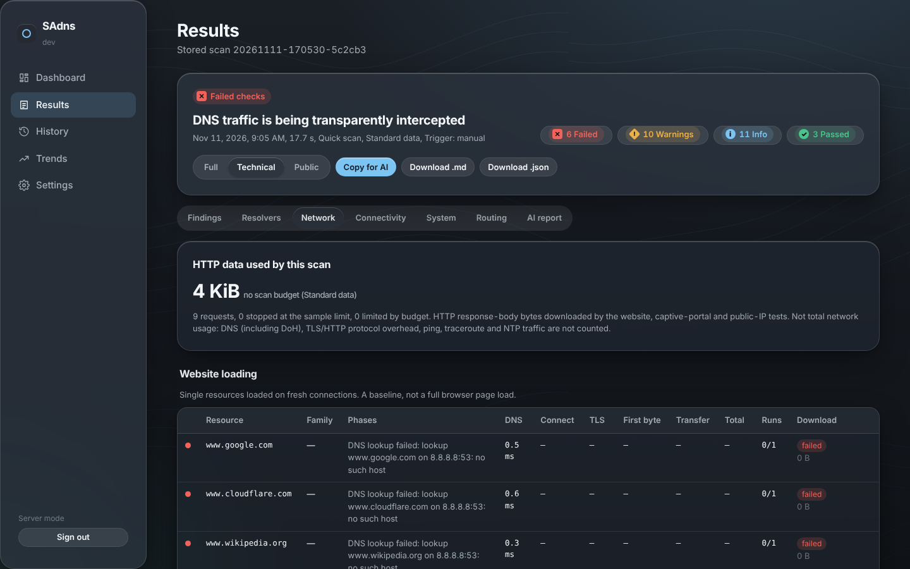

# SAdns

**Full-scope DNS & network diagnostics in one download.** SAdns checks your OS DNS configuration, your router or local resolver (UniFi, Pi-hole, AdGuard Home, ISP router) and the major public resolvers over IPv4 *and* IPv6. It then produces a technical report you can paste straight into an AI assistant (or hand to a network engineer) to get the problem fixed.


- **One file, no install, no dependencies.** It's a single static binary for Windows, macOS and Linux (x86 and ARM). The code uses only the Go standard library, with zero third-party modules.
- **Browser UI.** Double-click it and a dashboard opens in your browser. Live progress, findings, a resolver matrix and one-click **Copy report for AI**.
- **Terminal mode.** Use `sadns run` for servers, SSH sessions and automation. It writes Markdown and JSON reports.
- **Runs locally.** The report is generated on your machine and never uploaded. The probes themselves do contact public services (listed under [Privacy](#privacy)).
- **Path overview.** Results are grouped along the path *this device → Wi-Fi/LAN → router → internet → DNS → websites*; a layer that could not be tested is shown as "not tested", never as healthy, and a scan with significant gaps is reported as *partial*, not *healthy*.
- **Honest about certainty.** Every finding carries evidence, a fix and a confidence level (confirmed / suspected / inconclusive), and the report lists anything that could not be tested.


<sub>Screenshot from a lab VM whose network transparently intercepts all DNS — SAdns flags it as the root cause.</sub>



The interface uses a Liquid Glass–style tinted dark theme; pick a tint with the swatches in the toolbar.

## What it tests

| Area | Checks |
|---|---|
| **Connectivity** | IPv4 and IPv6 reachability (TCP to Cloudflare/Google/Quad9 anycast), "IPv6 configured but broken" detection, public IPs, NAT/CGNAT/double-NAT hints, clock skew, TLS interception |
| **OS resolver path** | What apps actually experience: lookups through `getaddrinfo`/Windows DNS Client/mDNSResponder, hosts file, search domains, NXDOMAIN rewriting, IPv6-only names, dual-stack (Happy Eyeballs) reachability |
| **Every configured resolver** (system, stub, gateway, custom) | UDP and TCP/53, A/AAAA, latency (median/p90/jitter/loss), uncached latency, EDNS0, truncation→TCP fallback, large-UDP/fragmentation drops, DNSSEC validation, NXDOMAIN integrity, ad/tracker filtering, server fingerprint (dnsmasq/Unbound/BIND…), upstream egress network |
| **Protocol compliance & behaviour** | 0x20 case preservation, EDNS version negotiation (BADVERS), DNS Cookies (two-step), HTTPS/SVCB records against a known-positive control, burst handling (5 → 20 → 20), caching timed against the network RTT (local cache vs upstream cache vs none), DNS-rebinding protection with control names |
| **Network signals** | DDR (`_dns.resolver.arpa`, the encrypted-DNS discovery Windows 11/Apple use), Firefox DoH canary (`use-application-dns.net`), iCloud Private Relay canary (`mask.icloud.com`), open DoT/DoH ports on local resolvers |
| **Website loading** | HTTPS resources loaded several times on fresh connections and split into DNS → TCP connect → TLS → first byte → transfer, over IPv4 and IPv6 separately, with measured wall-clock time, redirects, completeness and transfer rate. Add your own URLs (a slow site, a specific image) with `--url` or in the UI. These are single resources, not full browser page loads |
| **Network health** | Ping loss/latency/jitter to the gateway (Wi-Fi/LAN quality) and the internet, path MTU discovery (PPPoE/VPN/tunnel detection), NTP reachability and clock offset, captive-portal / HTTP-proxy detection with the Google/Apple/Microsoft connectivity probes, NAT64/DNS64, local hostname/PTR lookups, WPAD exposure |
| **Public resolvers** | Cloudflare, Google, Quad9, OpenDNS, AdGuard and Control D, on primary and secondary addresses over IPv4 and IPv6, plus DNS-over-TLS (853) and DNS-over-HTTPS (443) |
| **Failover** | Redundancy (single resolver, same-host duplicates), dead primaries, mixed local+public resolvers (filtering bypass, broken local names), the OS failover model and worst-case delay |
| **Interception** | Queries to never-routed documentation addresses (any reply = transparent DNS redirect), egress-ASN verification that "8.8.8.8" is really Google, tampered answers from public resolvers |
| **Routing** | Kernel route/source selection per resolver, VPN detection, traceroute (IPv4 + IPv6) via the system's own tool |

Each finding comes with **evidence** (the exact test results behind it), a **suggested fix** and a **confidence**: *confirmed* (independent checks agree), *suspected* (another cause is possible — alternatives are named) or *inconclusive*. DNSSEC is only reported as validating when the rejection is attributable to DNSSEC (Extended DNS Error or a CD=1 bypass), and DNS interception is only *confirmed* by the bogon probe or several independent indicators — an unexpected ASN alone is just *suspected*. The report also includes the raw command output (`resolvectl`, `scutil --dns`, `ipconfig /all`, route tables…), so an AI can double-check the conclusions.

## Quick start

1. Download the file for your system from **[Releases](https://github.com/StormAvenger/SAdns/releases)**:
   - Windows: `sadns-windows-amd64.exe` (or `-arm64`)
   - macOS: `sadns-darwin-arm64` (Apple Silicon) or `-amd64` (Intel)
   - Linux: `sadns-linux-amd64` / `-arm64` / `-arm`
2. Run it:
   - **Windows:** double-click. If SmartScreen says "Windows protected your PC", click *More info → Run anyway*. The binaries are not code-signed yet.
   - **macOS:** `chmod +x sadns-darwin-arm64 && xattr -d com.apple.quarantine sadns-darwin-arm64 && ./sadns-darwin-arm64`
   - **Linux:** `chmod +x sadns-linux-amd64 && ./sadns-linux-amd64`
3. Click **Run diagnostics**. A full scan takes about 30–90 s (traceroutes, ping series and path-MTU probing run alongside the DNS tests).
4. Click **Copy report for AI** and paste it into ChatGPT, Claude, Gemini, etc. The report starts with instructions for the AI.

No admin/root rights are needed.

## Terminal mode

```bash
sadns run                         # full scan, writes sadns-report-<time>.md and .json
sadns run --quick                 # primary addresses only, no traceroute
sadns run --resolver 192.168.1.2  # also test a Pi-hole / AdGuard Home / second router
sadns run --providers cloudflare,quad9 -6
sadns run --privacy public --stdout md  # print a share-safe report to stdout
sadns ui --no-browser             # start the UI and print its URL
```

| Flag | Meaning |
|---|---|
| `--quick` | Primary address per provider/family, 3 samples, no traceroute |
| `--url URL` | Also time this website/resource (repeatable, max 5), e.g. an image that loads slowly |
| `--resolver ip[:port]` | Extra resolver(s) to test (repeatable / comma-separated) |
| `--providers list` | `cloudflare,google,quad9,opendns,adguard,controld`, or `none` |
| `-4` / `-6` | Test only one address family |
| `--samples N`, `--timeout 2s` | Latency samples and per-query timeout |
| `--no-traceroute`, `--no-encrypted` | Skip traceroutes / DoT+DoH |
| `--privacy LEVEL` | `technical` (default), `public` (also LAN IPs/domains) or `full` — see [Privacy](#privacy) |
| `--out DIR`, `--stdout md\|json` | Where the report goes |

With no command, SAdns opens the UI on desktops and falls back to terminal mode on headless systems.

## Privacy

**What leaves your machine:** only the test traffic. SAdns sends DNS queries to your configured resolvers, your gateway and the public resolvers you select; ICMP/UDP traceroutes and pings to `1.1.1.1` / `2606:4700:4700::1111`; HTTPS to `one.one.one.one/cdn-cgi/trace` (public IP, clock); NTP to `time.cloudflare.com` and `time.google.com`; HTTP to the Google/Apple/Microsoft connectivity-check URLs; HTTPS page loads from google.com, cloudflare.com, wikipedia.org and github.com; DNS lookups of test names on `nip.io`/`sslip.io`, `dnssec-failed.org`, `ietf.org`, Team Cymru's ASN service and the canary domains. Those services see your IP address, as with any connection. **The report itself is never uploaded.**

**Sharing the report:** choose a privacy level when you copy or download it (default **Technical**):

| Level | Hides | Keeps |
|---|---|---|
| **Public-safe** | your public IPs, IPv6 prefix, hostname, MACs, client subnet, **LAN IPs** (→ consistent `[lan-ip-N]` placeholders), internal/search domains, your ISP resolver's IP | public resolver addresses, all test results |
| **Technical** (default) | your public IPs, IPv6 prefix, hostname, MACs, client subnet | LAN layout (gateway/DNS IPs, domains) an expert needs |
| **Full** | nothing — only share with people you trust | everything |

Redaction is applied to the final Markdown/JSON, so it also covers raw command output (`ipconfig /all`, `scutil`, `resolvectl`, traceroutes). Tests check that no identifier survives either level. CLI: `--privacy public|technical|full`.

**The local UI** only listens on loopback (`--listen` refuses anything else). It is opened with a one-time token that is immediately swapped for an HttpOnly, SameSite=Strict session cookie and removed from the address bar. POSTs also need a custom header (CSRF), non-loopback `Host` headers are rejected (DNS rebinding), and a hash-pinned Content-Security-Policy allows only the shipped script and stylesheet.

## How it works

```
cmd/sadns        CLI entry point (ui / run)
internal/sysinfo    interfaces, gateways, OS resolvers (Linux: resolv.conf, systemd-resolved, procfs;
                    macOS: scutil --dns, route; Windows: one PowerShell inventory call)
internal/dnswire    small DNS wire-format codec (EDNS0, NSID, Extended DNS Errors) — fuzz tested
internal/dnsclient  UDP / TCP / DoT / DoH exchanges to an explicit IP (never the OS resolver or a proxy)
internal/probe      the test suite, connectivity, interception, traceroute, provider catalog
internal/analyze    rules that turn measurements into findings with evidence + fixes
internal/report     Markdown (AI-optimised) and JSON renderers, redaction
internal/web        embedded single-page UI + loopback HTTP server (Server-Sent Events for live progress)
internal/mockdns    configurable fake resolver used by tests (healthy, broken, hijacking, filtering)
```

All DNS tests talk directly to the IP under test, so each result reflects that server and that network path only. Every response is validated (QR flag, ID, opcode, question, well-formedness) before it counts as an answer.

**OS-path caveat:** on Windows and macOS the "OS resolver path" lookups go through the system resolver APIs. On Linux/BSD the static release builds use Go's own resolver, which reads `resolv.conf` and the hosts file but not glibc `nsswitch` modules (mdns, nss-resolve, LDAP). The report says so in its coverage section.

## Building from source

Requires Go 1.24+ (release binaries are built with the latest stable Go, which current macOS versions require).

```bash
git clone https://github.com/StormAvenger/SAdns && cd SAdns
make build        # ./sadns
make test         # unit + mock-resolver integration tests
make dist         # all release binaries + SHA256SUMS into dist/
make mock         # start local mock resolvers for offline UI work
```

Releases are built by GitHub Actions: push a `v*` tag, or run **Actions → Release → Run workflow** with a version. Each release gets SHA-256 checksums and a build-provenance attestation (`gh attestation verify <file> --repo StormAvenger/SAdns`). CI runs on Linux, Windows and macOS with the race detector, staticcheck and govulncheck.

## Roadmap

- **Scan orchestrator:** adaptive follow-up tests chosen from the evidence, with per-probe budgets and a structured evidence store (evidence IDs, contradicting evidence, verification steps per finding)
- **Browser-backed page tests:** full resource waterfalls, HTTP/2 vs HTTP/3 (QUIC), browser Secure-DNS detection
- **Device & link telemetry:** NIC speed/duplex/errors, Wi-Fi signal/channel/roaming, TCP retransmissions, proxy/PAC settings
- **Intermittent problems:** monitor mode with a rolling buffer and an "it just happened" button; multi-device comparison; case-bundle export
- **Gateway integrations (read-only):** UniFi, Pi-hole and AdGuard Home APIs — firmware, WAN DNS, DNS Shield, content filtering, VLANs, IPv6 settings — for equipment-specific fixes
- **What the network hands out:** DHCP option 6 and IPv6 RA/RDNSS vs what the OS actually uses; prefix-delegation health
- **Measured failover:** controlled tests instead of documented-behaviour estimates
- **More protocols:** DNS-over-QUIC, DoH over HTTP/3, HTTPS/SVCB parameter inspection, negative-caching and stale-answer behaviour
- **History & monitoring:** baselines, before/after comparison, scheduled JSON output, Docker image for Unraid
- **Guided diagnostics:** start from a symptom ("Wi-Fi calls drop", "one site won't load") and run the relevant checks
- Signed/notarised Windows and macOS binaries

See [CHANGELOG.md](CHANGELOG.md) for what is already implemented.

## Contributing

Issues and pull requests are welcome — see [CONTRIBUTING.md](CONTRIBUTING.md). If SAdns misdiagnoses your network, open an issue with the **Public-safe** JSON report attached; that's the fastest way to improve the rules. Security issues: see [SECURITY.md](SECURITY.md).

## License

MIT
