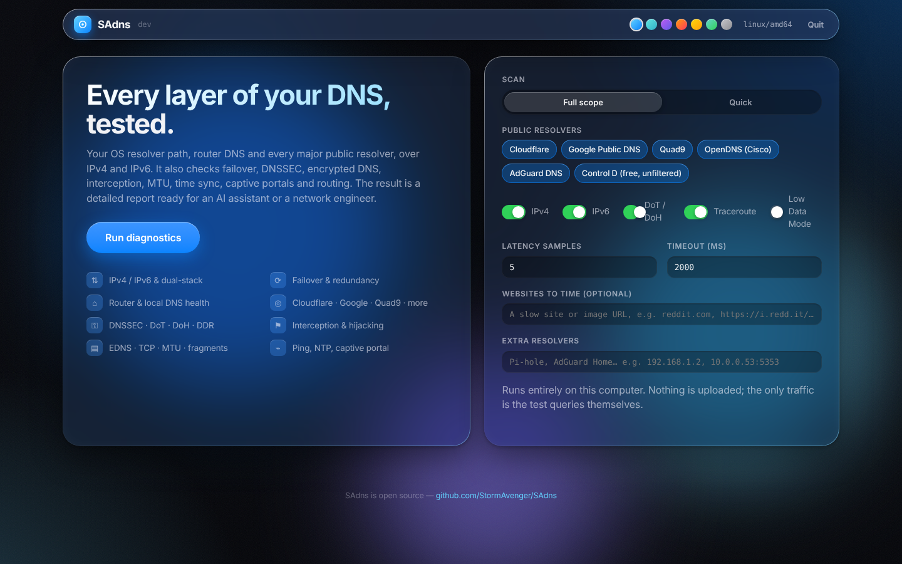
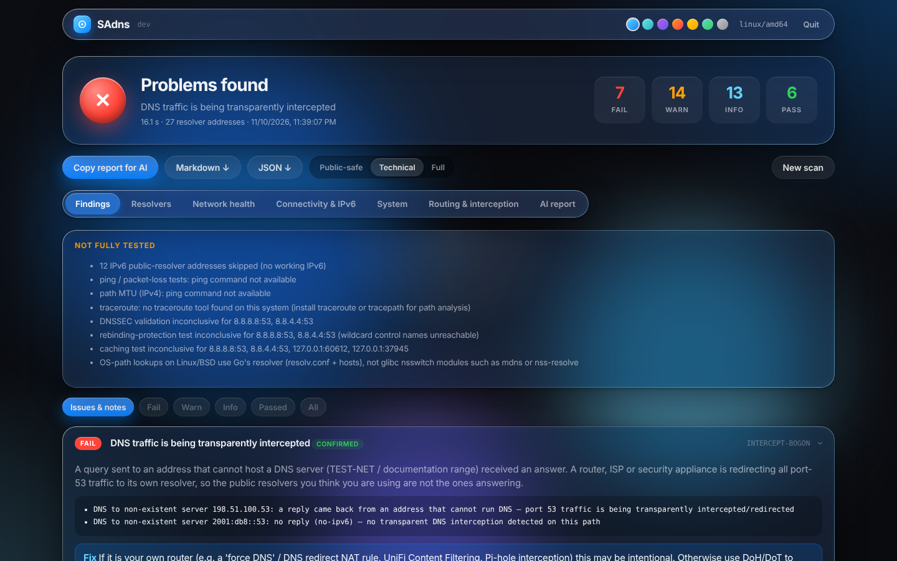

# SAdns

**Full-scope DNS & network diagnostics in one download.** SAdns checks your OS DNS configuration, your router or local resolver (UniFi, Pi-hole, AdGuard Home, ISP router) and the major public resolvers over IPv4 *and* IPv6. It then produces a technical report you can paste straight into an AI assistant (or hand to a network engineer) to get the problem fixed.



- **One file, no install, no dependencies.** It's a single static binary for Windows, macOS and Linux (x86 and ARM). The code uses only the Go standard library, with zero third-party modules.
- **Browser UI.** Double-click it and a dashboard opens in your browser. Live progress, findings, a resolver matrix and one-click **Copy report for AI**.
- **Terminal mode.** Use `sadns run` for servers, SSH sessions and automation. It writes Markdown and JSON reports.
- **Local and private.** Everything runs on your machine. Nothing is uploaded, and the only network traffic is the test queries themselves.



<sub>Screenshot from a lab VM whose network transparently intercepts all DNS — SAdns flags it as the root cause.</sub>

## What it tests

| Area | Checks |
|---|---|
| **Connectivity** | IPv4 and IPv6 reachability (TCP to Cloudflare/Google/Quad9 anycast), "IPv6 configured but broken" detection, public IPs, NAT/CGNAT/double-NAT hints, clock skew, TLS interception |
| **OS resolver path** | What apps actually experience: lookups through `getaddrinfo`/Windows DNS Client/mDNSResponder, hosts file, search domains, NXDOMAIN rewriting, IPv6-only names, dual-stack (Happy Eyeballs) reachability |
| **Every configured resolver** (system, stub, gateway, custom) | UDP and TCP/53, A/AAAA, latency (median/p90/jitter/loss), uncached latency, EDNS0, truncation→TCP fallback, large-UDP/fragmentation drops, DNSSEC validation, NXDOMAIN integrity, ad/tracker filtering, server fingerprint (dnsmasq/Unbound/BIND…), upstream egress network |
| **Public resolvers** | Cloudflare, Google, Quad9, OpenDNS, AdGuard and Control D, on primary and secondary addresses over IPv4 and IPv6, plus DNS-over-TLS (853) and DNS-over-HTTPS (443) |
| **Failover** | Redundancy (single resolver, same-host duplicates), dead primaries, mixed local+public resolvers (filtering bypass, broken local names), the OS failover model and worst-case delay |
| **Interception** | Queries to never-routed documentation addresses (any reply = transparent DNS redirect), egress-ASN verification that "8.8.8.8" is really Google, tampered answers from public resolvers |
| **Routing** | Kernel route/source selection per resolver, VPN detection, traceroute (IPv4 + IPv6) via the system's own tool |

Each finding comes with **evidence** (the exact test results behind it) and a **suggested fix**. The report also includes the raw command output (`resolvectl`, `scutil --dns`, `ipconfig /all`, route tables…), so an AI can double-check the conclusions.

## Quick start

1. Download the file for your system from **[Releases](https://github.com/StormAvenger/SAdns/releases)**:
   - Windows: `sadns-windows-amd64.exe` (or `-arm64`)
   - macOS: `sadns-darwin-arm64` (Apple Silicon) or `-amd64` (Intel)
   - Linux: `sadns-linux-amd64` / `-arm64` / `-arm`
2. Run it:
   - **Windows:** double-click. If SmartScreen says "Windows protected your PC", click *More info → Run anyway*. The binaries are not code-signed yet.
   - **macOS:** `chmod +x sadns-darwin-arm64 && xattr -d com.apple.quarantine sadns-darwin-arm64 && ./sadns-darwin-arm64`
   - **Linux:** `chmod +x sadns-linux-amd64 && ./sadns-linux-amd64`
3. Click **Run diagnostics**. A full scan takes about 20–60 s, mostly traceroutes.
4. Click **Copy report for AI** and paste it into ChatGPT, Claude, Gemini, etc. The report starts with instructions for the AI.

No admin/root rights are needed.

## Terminal mode

```bash
sadns run                         # full scan, writes sadns-report-<time>.md and .json
sadns run --quick                 # primary addresses only, no traceroute
sadns run --resolver 192.168.1.2  # also test a Pi-hole / AdGuard Home / second router
sadns run --providers cloudflare,quad9 -6
sadns run --redact --stdout md    # print a redacted report to stdout
sadns ui --no-browser             # start the UI and print its URL
```

| Flag | Meaning |
|---|---|
| `--quick` | Primary address per provider/family, 3 samples, no traceroute |
| `--resolver ip[:port]` | Extra resolver(s) to test (repeatable / comma-separated) |
| `--providers list` | `cloudflare,google,quad9,opendns,adguard,controld`, or `none` |
| `-4` / `-6` | Test only one address family |
| `--samples N`, `--timeout 2s` | Latency samples and per-query timeout |
| `--no-traceroute`, `--no-encrypted` | Skip traceroutes / DoT+DoH |
| `--redact` | Replace your public IPs, IPv6 prefix, hostname and MACs with placeholders |
| `--out DIR`, `--stdout md\|json` | Where the report goes |

With no command, SAdns opens the UI on desktops and falls back to terminal mode on headless systems.

## Privacy

The report contains your network layout: local IPs, public IP, ISP network and DNS servers. That is exactly what someone diagnosing it needs. Tick **Redact personal info** (or pass `--redact`) before sharing it publicly. Resolver addresses are kept, since they're needed for diagnosis.

The UI server listens only on `127.0.0.1` and uses a random per-launch token. It rejects non-loopback `Host` headers to block DNS-rebinding attacks, and requires a custom header on POST requests so other websites can't drive it.

## How it works

```
cmd/sadns        CLI entry point (ui / run)
internal/sysinfo    interfaces, gateways, OS resolvers (Linux: resolv.conf, systemd-resolved, procfs;
                    macOS: scutil --dns, route; Windows: one PowerShell inventory call)
internal/dnswire    small DNS wire-format codec (EDNS0, NSID, Extended DNS Errors) — fuzz tested
internal/dnsclient  UDP / TCP / DoT / DoH exchanges to an explicit IP (never the OS resolver or a proxy)
internal/probe      the test suite, connectivity, interception, traceroute, provider catalog
internal/analyze    rules that turn measurements into findings with evidence + fixes
internal/report     Markdown (AI-optimised) and JSON renderers, redaction
internal/web        embedded single-page UI + loopback HTTP server (Server-Sent Events for live progress)
internal/mockdns    configurable fake resolver used by tests (healthy, broken, hijacking, filtering)
```

All DNS tests talk directly to the IP under test, so each result reflects that server and that network path only.

## Building from source

Requires Go 1.22+.

```bash
git clone https://github.com/StormAvenger/SAdns && cd SAdns
make build        # ./sadns
make test         # unit + mock-resolver integration tests
make dist         # all release binaries + SHA256SUMS into dist/
make mock         # start local mock resolvers for offline UI work
```

Releases are built by GitHub Actions: push a `v*` tag, or run **Actions → Release → Run workflow** with a version.

## Roadmap

- Path-MTU / fragmentation probing (PPPoE/VPN MTU problems)
- DNS-over-QUIC, DNS rebinding-protection and DNS64/NAT64 checks
- Which DNS the router hands out (DHCP option 6 / RA RDNSS) vs what the OS uses
- Optional read-only UniFi / Pi-hole / AdGuard Home API integration
- Local-name tests (`.local` mDNS, `.lan`, reverse lookups)
- Continuous monitor mode and a Docker image (Unraid Community Apps)
- Code-signed Windows/macOS binaries

## Contributing

Issues and pull requests are welcome. If SAdns misdiagnoses your network, open an issue with the (redacted) JSON report attached. That's the fastest way to improve the rules in `internal/analyze`.

## License

MIT
